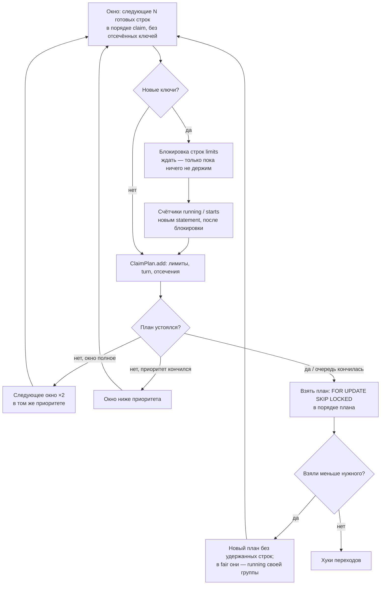

# Claim по окнам

Разбор W6-8 (`fair` без полного скана) и W6-9 (claim за заблокированной головой) из [[14 — Пул задач после 0.5.0]]. Обе задачи закрыты одним изменением, akadze #53. Здесь записаны замеры, отвергнутые варианты, рассуждение о точности и что осталось открытым.

## Было

Claim в 0.5.0 — один большой SQL. CTE `ready` читает готовые строки очереди, затем лимиты, `row_number()` по ключу, для `fair` — второй `row_number()` по группе и загрузка групп, в конце `FOR UPDATE SKIP LOCKED`. Порядок по умолчанию сначала пробует голову (`slots × 4` строк). Если голова не набрала `slots`, он откатывается к savepoint и делает полный скан. `fair` сканирует всегда.

Замер `main` (a12036b), Postgres 16, `slots=20`, 100 тыс. готовых задач, медиана 15 claim:

| очередь | default | fair |
|---|---|---|
| 50 ключей, у одного 19 тыс. в голове | 2.6 мс | 190 мс |
| 20 тыс. ключей × 5 | 3.5 мс | 313 мс |
| без ключей | 3.7 мс | 120 мс |
| первые 50 тыс. — ключ на лимите | 187 мс | 159 мс |
| все 100 тыс. — ключ на лимите | 93 мс | 92 мс |
| 1000 ключей на лимите вперемешку, затем 100 свободных | 201 мс | 252 мс |
| 5 тыс. срочных над 95 тыс. | 3.8 мс | 255 мс |
| 2000 running в 200 группах, 100 тыс. в 400 | 2.9 мс | 276 мс |

Где уходит время в `fair` (EXPLAIN на 20 тыс. ключей, 359 мс): чтение 100 тыс. строк ~20 мс, три hash join ~40 мс, сортировка по `limit_key` для `row_number()` ~110 мс (text в collation базы), вторая сортировка ~20 мс, join обратно на `jobs` ~35 мс, финальная сортировка ~50 мс. Дорого не чтение, а ранжирование всех строк.

## Отвергнутые варианты

**Индекс по группе и skip-scan.** Индекс `(queue, priority DESC, limit_key, run_at, id) WHERE state = 'queued'`, рекурсивный CTE перебирает различные `limit_key`, для каждого — первая готовая строка. На 20 тыс. групп это 360 мс: ~18 мкс на шаг рекурсии. Медленнее полного скана, плюс миграция с индексом на `jobs` (A10) и рост стоимости записи. Отвергнут.

**Голова с проверкой «turn = 1».** Если в голове нашлось `slots` первых строк незанятых групп, результат точный: ни одна непрочитанная строка не получит turn меньше 1, а при равенстве проигрывает по `run_at`. Покрывает много-групповой случай. Не покрывает глубокий хвост одной группы, а это ровно случай, ради которого делался `fair`. Вошёл в итоговое решение как условие остановки.

**Быстрее ранжировать весь хвост** (`COLLATE "C"`, одна сортировка). По оценке 60–80 мс, всё ещё O(N) с сортировкой. Не делали.

## Решение

Claim читает очередь окнами в порядке claim и решает в Python, что брать (`akadze/claim.py`, чистый `ClaimPlan`). Следующее окно не читает строки, которые плану заведомо не нужны:

- **ключ на лимите** («blocked»): ключ с `left` свободными стартами пропускает первые `left` строк, дальше всё отсечено до конца claim;
- **закрытая группа `fair`** («capped»): следующий turn группы больше turn последней нужной строки на этом приоритете, или в группе уже `slots` строк с turn.

Отсечение — фильтр `limit_key <> ALL(:excluded)` в окне по `jobs_claim_idx`. Строки отсечённых групп индекс проходит, но не ранжирует. Полное чтение 100 тыс. строк с таким фильтром стоит ~12–17 мс, без сортировки.

### Почему план точный

План совпадает с результатом полного скана старого SQL при тех же снимках.

- **Порядок по умолчанию.** Строки читаются по возрастанию порядка claim. Отсечённые строки принадлежат ключам на лимите и не прошли бы проверку лимита. Первые `slots` прошедших строк — префикс полного скана.
- **`fair`.** Внутри приоритета каждая прочитанная строка знает свой точный turn: число running в группе плюс место среди строк группы, прошедших лимит. Место точное, потому что чтение идёт по `run_at`. Непрочитанная строка непрочитанной группы имеет turn ≥ 1 и более поздний `run_at`, поэтому при `cut = 1` план устоялся. Строки закрытой группы имеют turn больше `cut`, а `cut` со временем только уменьшается. Значит, всё, что не прочитано, проигрывает.
- **Приоритеты.** Ниже приоритета claim спускается, только если текущий кончился и не дал нужного числа строк. Значит, в нём не было закрытых групп. Место ключа под лимитом при этом посчитано по всем его строкам выше.

Проверка: дифференциальный прогон против старого SQL на случайных очередях. Варьировались ключи, `max_running` / `max_starts`, отметки стартов, нагрузка running, приоритеты, будущий `run_at`, запросы отмены, незарегистрированные задачи, `slots` 1/3/7/20, оба порядка. 3 520 claim, расхождений 0. Многооконных claim — ~19 %, с отсечением — ~20 %. Прогон поймал одну ошибку до PR: пустой срез после закрытия приоритета в `fair`.

### Блокировки (W6-1 сохраняется)

Строки `limits` блокируются отдельным statement, счётчики читаются следующим, уже после блокировки. Ждать блокировку claim может, только пока не держит ни одной строки `limits` и ни одной задачи. После этого он блокирует через `SKIP LOCKED`, и ключ, который держит другой claim, ждёт следующего claim. Так два claim, которые берут ключи в разных окнах в разном порядке, не взаимоблокируются.

Изменение под нагрузкой: раньше полный скан ждал блокировку *всех* ключей очереди. Теперь второй и следующие ключи пропускаются, если заняты. Это то же правило, что «ключ вне заблокированного набора ждёт следующего claim» из W6-1.

### Удержанные строки

Если план не взялся целиком (строки держит другой claim), строится новый план без этих строк. В `fair` каждая удержанная строка считается running своей группы, потому что станет ею, когда её claim закоммитит. Старый SQL в `fair` в такой ситуации не брал ничего: кандидатами были только первые `slots` строк группы. Новый берёт следующие.

## Итог

| очередь | default до → после | fair до → после |
|---|---|---|
| 50 ключей, один в голове | 2.6 → 2.4 мс | 190 → 4.3 мс |
| 20 тыс. ключей × 5 | 3.5 → 2.5 мс | 313 → 2.6 мс |
| без ключей | 3.7 → 2.1 мс | 120 → 17.9 мс |
| первые 50 тыс. на лимите (W6-9) | 187 → 5.7 мс | 159 → 4.2 мс |
| все 100 тыс. на лимите | 93 → 16.1 мс | 92 → 17.2 мс |
| 1000 ключей на лимите, затем свободные | 201 → ~14 мс | 252 → ~15 мс |
| срочные над хвостом | 3.8 → 3.8 мс | 255 → 4.6 мс |
| 200 занятых групп из 400 | 2.9 → 3.8 мс | 276 → 7.3 мс |

Конкуренция: 10 параллельных claim на 20 тыс. задач с 20 ключами под лимитом, по 20 с, задачи завершаются случайно. Default — 8 610 claim против 2 796 на `main`; `fair` — 5 387 против 3 340. Ошибок 0, моментов с `running > max_running` 0.

Схема не меняется, публичный API не меняется. П. 5 критериев Beta ([[12 — Публичная поверхность и критерии Beta]]) закрыт для обоих режимов.

## Открыто

- Худший случай по-прежнему линеен: одна группа в `fair` или вся очередь на лимите — полное чтение индекса, ~17 мс на 100 тыс. На миллионе это ~170 мс. Ускорить можно только индексом с `limit_key` или счётчиками групп в отдельной таблице. Обе — изменения схемы; делать, только если появится потребитель с такими объёмами.
- Под нагрузкой точность `fair` зависит от снимка, как и раньше. Удержанные строки считаются running заранее, и это может быть неточно, если строку держит не claim (например, `jobs cancel`). Безвредно: следующий claim пересчитывает.
- Предикаты готовности теперь в трёх местах: окно claim, проверка в `_take`, `testing._READY`. Кандидат в следующую волну — общий источник (уже записан у W6-7).
